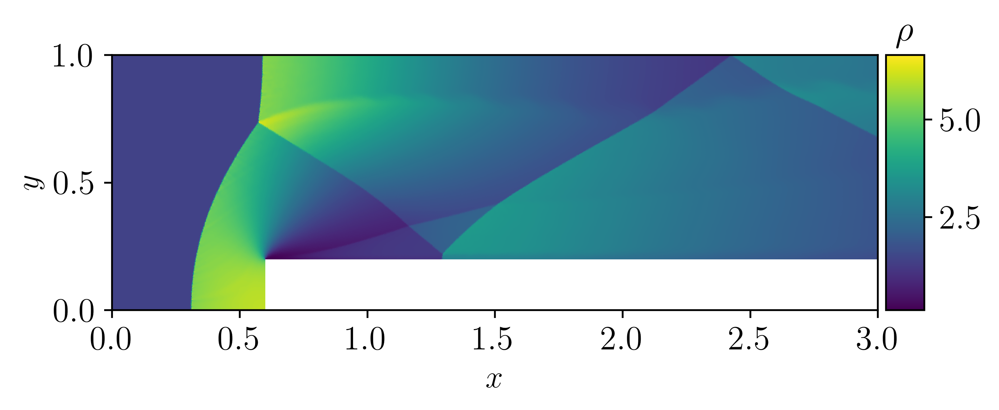
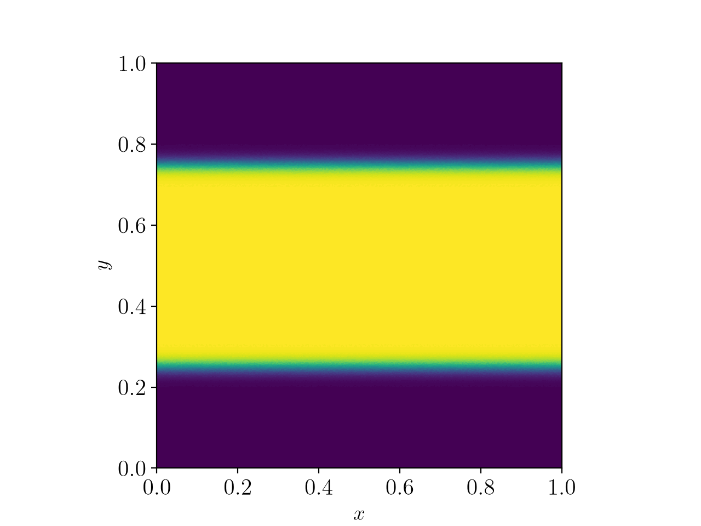
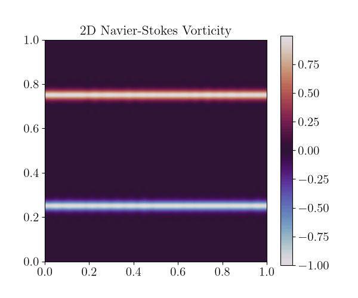

# JAX-FVM
JAX-FVM is a differentiable finite volume method (FVM) based on [JAX](https://github.com/jax-ml/jax), designed for **unstructured meshes**. The compressible solvers work directly on arbitrary 2D triangular meshes, so complex geometries (steps, obstacles, non-rectangular domains) can be handled without a structured grid. Because it is written in JAX, every solver supports automatic differentiation (AD), `jit` compilation and runs on GPUs. The method and its validation are presented in [*JAX-FVM: A differentiable, entropy-stable finite volume solver on unstructured meshes for compressible flows*](https://arxiv.org/abs/2607.07385) (arXiv:2607.07385).

The repository has three main solvers:

| Solver | Equations | Discretisation | Location |
|---|---|---|---|
| **Euler** | 2D compressible Euler | Finite volume, unstructured triangles | [`src/solvers/Euler`](src/solvers/Euler) |
| **Compressible NS** | 2D compressible Navier–Stokes | Finite volume, unstructured triangles | [`src/solvers/compressible_NS`](src/solvers/compressible_NS) |
| **Spectral incompressible NS** | 2D incompressible NS (vorticity form) | Fourier pseudo-spectral, periodic | [`src/solvers/Vorticity_NS`](src/solvers/Vorticity_NS) |

Test cases (Kelvin–Helmholtz, dipole vortex, co-rotating vortex merger, double Mach reflection, …) are set up with YAML files in [`src/Cases/config`](src/Cases/config).

## Solvers

### 1. Euler equations (FVM)
A cell-centred finite volume solver on unstructured 2D triangular meshes (built with Meshpy).
- First order, or second order with MUSCL reconstruction: least-squares gradients and Venkatakrishnan or minmod limiters
- Numerical fluxes: Roe, Rusanov, and Tadmor's entropy-conservative flux
- Explicit time integration (RK2, RK4) and implicit time integration (Newton, SDIRK2)

It is based on classical textbook FVM methods for hyperbolic conservation laws (Godunov-type schemes, Roe's approximate Riemann solver, MUSCL reconstruction, Tadmor's entropy-conservative fluxes).



### 2. Compressible Navier–Stokes (FVM)
This solver builds on the Euler solver. It reuses the convective part (MUSCL + Tadmor flux) and adds viscous and heat fluxes, which are computed from face gradients of velocity and temperature. The time step is limited by both the convective and the viscous CFL conditions. During the run, it tracks diagnostics such as total entropy, enstrophy and kinetic energy.



### 3. Spectral incompressible Navier–Stokes
A standalone 2D Fourier pseudo-spectral solver for the incompressible NS equations in vorticity–streamfunction form on a periodic domain.
- Dealiasing with the 2/3 rule
- IMEX RK2 time integration (ARS(2,2,2)): the advection is explicit, and the viscosity and drag terms are implicit
- Optional forcings (shell, Kolmogorov, stochastic) and diagnostics: energy, enstrophy, palinstrophy, energy spectrum

The setup and the stochastic forcing follow *Physics-aware generative models for turbulent fluid flows through energy-consistent stochastic interpolants* (ScienceDirect).



## Documentation
Small examples are in the [`examples`](examples) folder. To run a solver, launch its script from its own folder, for example:
```bash
cd src/solvers/compressible_NS && python solver.py
```
To change the test case, edit `cfg_path` in the `__main__` block.

## License
This project is licensed under the GNU General Public License v3 - see the LICENSE for details. For commercial use, contact Guillaume de Romémont (guillaume at romemont dot protonmail dot com)

## Dependencies
The project is built using :
- jax-12 for GPUs
- [Meshpy](https://github.com/inducer/meshpy)
- [Meshio](https://github.com/nschloe/meshio)
- Latex for images outputs

## To cite this code
@article{de2026jax,
  title={JAX-FVM: A differentiable, entropy-stable finite volume solver on unstructured meshes for compressible flows},
  author={de Rom{\~A}{\v{S}}mont, Guillaume},
  journal={arXiv preprint arXiv:2607.07385},
  year={2026}
}